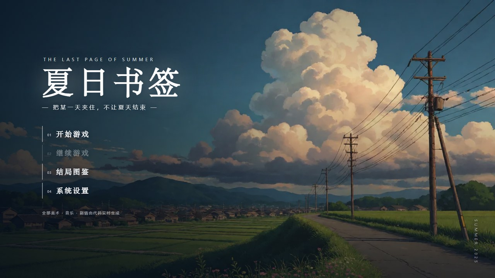
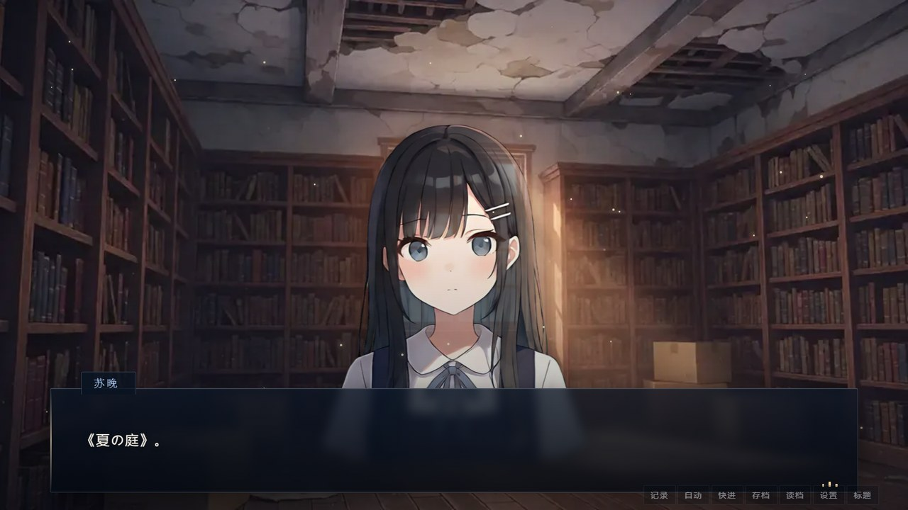

# 夏日书签 · The Last Page of Summer

一部可以在浏览器里直接玩的原创日式视觉小说（galgame）。单个 HTML 文件，**双击即玩，离线、零依赖**。

> 暑假第一天，你被派去收拾那间马上要拆的旧图书室。
> 里面有两个人在等你，还有一本没有书名的书。
> 下午五点的广播响起时，世界会重来一次。
> 这是第八次。





## 玩

https://3cancanneed.github.io/summer-bookmark/the-last-page-of-summer.html，双击用浏览器打开即可。

支持 Chrome / Edge / Firefox / Safari 的较新版本。第一次点击画面后才会出声（浏览器的自动播放限制）。

| 操作 | 说明 |
|---|---|
| 点击 / 空格 / 回车 | 推进对话 |
| 滚轮上翻 | 回看历史记录 |
| 按住 Ctrl | 快进 |
| 右键 或 H | 隐藏界面 |
| Esc | 打开记录 / 关闭面板 |

存档 6 槽，另有结局图鉴、音量与文字速度设置，全部存在浏览器 localStorage 里。

## 内容

- **三条线**：陪学姐整理书 · 去天台找小夏 · 先查清这本书是什么（第三条需要先通关任意结局才解锁）
- **五个结局**：两条感情线各 good / bad，外加一条收束全部的 TRUE END
- 约 800 句台词，15 个章节标签，11 种表情

## 技术

所有美术和部分音乐都是**运行时生成**的，仓库里没有一张手绘图：

| 部分 | 做法 |
|---|---|
| 剧本 | 纯数据（`js/story.js`），929 条指令，标签跳转 + 好感度 + 条件分支 |
| 立绘 | 12 张，由 AI 生成后切成透明 PNG/WebP，按表情映射 |
| 背景 | 13 张，AI 生成，1280×720 |
| BGM | 7 个场景用真实录音（2 个文件靠播放速率衍生 7 种情绪），2 个场景用 WebAudio 实时合成 |
| 音效 | 全部 WebAudio 合成（钟声、电话、蝉鸣、翻页等） |
| 引擎 | 无框架，约 1100 行原生 JS：打字机、分支、存档、图鉴、Auto/Skip |

构建产物是**单文件 HTML**：CSS、脚本、图片、音频全部 base64 内联，所以可以当作附件发出去，也可以丢在任何静态托管上。

## 自己构建

```bash
node tools/gen_assets.js   # assets/sprites + assets/bg -> js/assets.js
node tools/gen_audio.js    # assets/audio + _bgm_map.json -> js/bgm.js
node tools/build.js        # 打包成单文件 HTML
```

只想要一个能改的版本的话，直接用任意静态服务器打开仓库根目录就行，`index.html` 会按普通多文件方式加载。

```
index.html
css/style.css
js/story.js      剧本
js/art.js        立绘与场景（图片优先，SVG 兜底）
js/audio.js      BGM 与音效
js/engine.js     引擎
assets/sprites/  12 张立绘
assets/bg/       13 张背景
assets/audio/    2 首 BGM
_bgm_map.json    场景 -> 曲目 -> 播放速率的映射
tools/           构建脚本
```

`js/assets.js` 和 `js/bgm.js` 是生成产物，不在版本库里。

## 授权

- **代码**：MIT，见 [LICENSE](LICENSE)
- **剧本与角色**：原创，同样以 MIT 发布
- **立绘与背景**：由 AI 图像模型生成
- **BGM**：CC-BY，必须署名，见下

### 音乐署名

- **Peaceful Intro (Looping)** by Eric Matyas — [www.soundimage.org](https://www.soundimage.org)，CC-BY 3.0，[来源](https://opengameart.org/content/peaceful-intro-looping)
- **Sadness** by cesisco / Zander Noriega / TAD / Extenz，compiled by glitchart，CC-BY 4.0，[来源](https://opengameart.org/content/sadness-cesisco-zander-noriega-tad-extenz)

游戏内的「系统设置」面板底部也会显示这两条署名。

## 关于

一开始只是一句「给我生成个 galgame」。断断续续做了很久：剧本、引擎、UI、美术，立绘返工了十几轮才从代码画的 SVG 换成了生成图。
